# Informe · Práctica ProcLab (UT1)

**Alumno/a:** [Limbert y Lovera] · **Sistema operativo usado:** [Debian GNU/Linux (WSL2 sobre Windows 11)]

> Incluye en cada apartado los comandos, la salida relevante (o una captura de `capturas/`) y tus respuestas razonadas.
> Para insertar una captura: ``

## B0 · Preparación del entorno

- `gcc --version`:
- `salida por pantalla: gcc (Debian 14.2.0-19) 14.2.0`
-  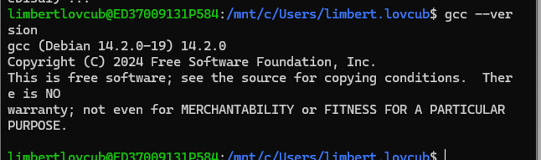
- `java -version`:
- `Salida por pantalla  : openjdk version "21.0.12.1" 2026-08-18`
- 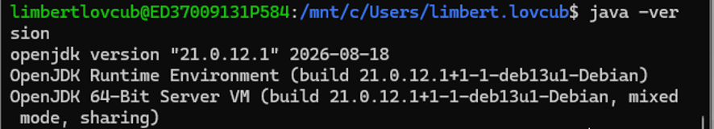
- `git log --oneline` tras el primer commit:
- Salida por pantalla `29c88d6 (HEAD -> master) Estructura de proyecto inicial y configuracion`
## B1 · Procesos en Linux y en C

### B1.1 · Exploración desde la terminal
1. Rama del árbol hasta el PID 1:
- 
- `El PID de la shel es 199`
- 
- Salida de pstree: `systemd(1)───init-systemd(De(2)───SessionLeader(197)───Relay(199)(198)───bash(199)───pstree(4544)`
2. Dos `sleep` en segundo plano (padre y estado):
- 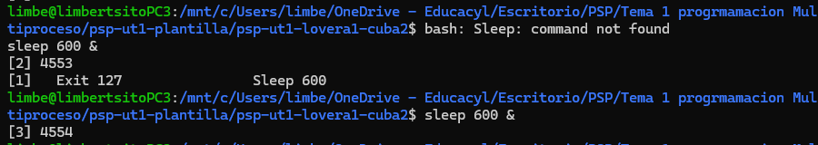
- La salida de los dos sleep son : `4553 y 4554`
- El padre de es el PID: `199 que corresponde a  /bin/bash`
- Su estado es : `"S" eso quiere decir que es Sleeping/bloqueado , están esperando algo, ambos procesos al estar en el estado "Sleeping" no malgastan tiempo de procesador`
- 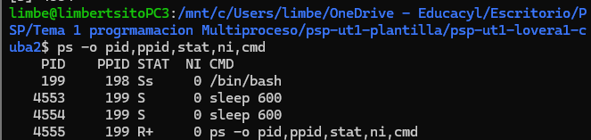
3. STOP/CONT y SIGTERM frente a SIGKILL:
- 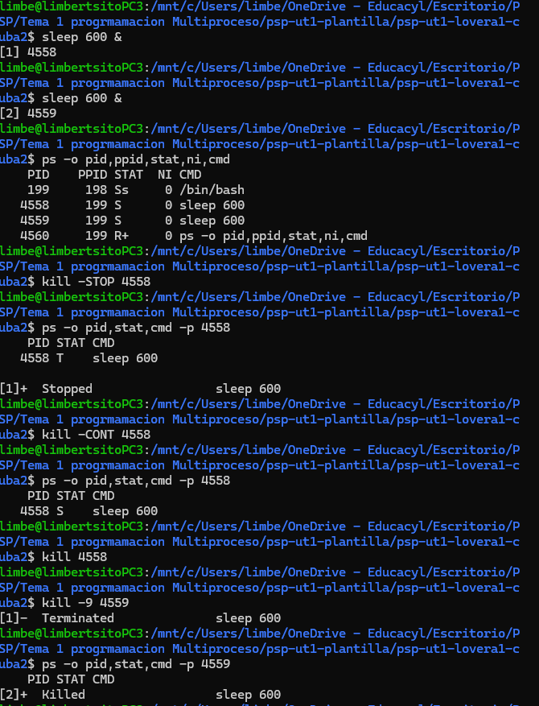
- La diferencia entre `kill y kill -9` es que kill manda la instruccion de cerrarse SIGTERM   y kill -9 fuerza la muerte del proceso con SIGKILL
4. `nice` y `renice`:
- 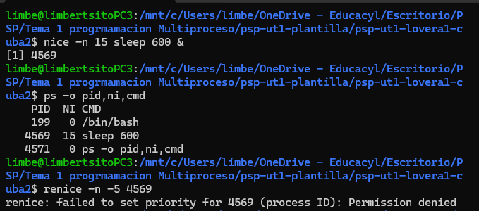
-  El sistema deniega la operación mostrando un error de permisos.
- Esto ocurre porque el valor `nice` gestiiona la prioridad del proceso , es decir a menor valor mayor pruioridad. Un usuario estandar tiene permitido ceder prioridad de sus 
- procesos  en valores positivos, pero no puede subir la prioridad de valores negativos, para estos privilegios tiene que tener derechos de administrador.
5. Cinco campos de `/proc/<PID>/status` relacionados con el BCP:
- 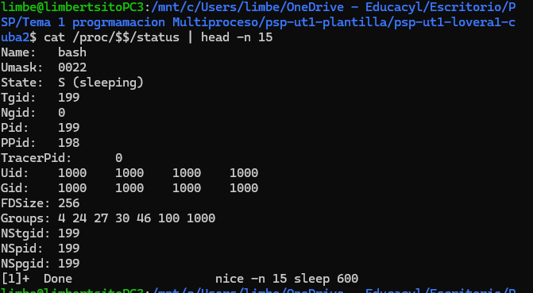
- Name : bash
- State : S
- Pid: 199
- PPid: 198 
- Uid: 1000 / Gid: 1000
6. Concurrencia/paralelismo y proceso/hilo; núcleos e hilos observados:
- la concurrencia es la capacidad del sistema de gestionar varias tareas a la vez , aunque parezca que ocurren simultaneamnete, la realidaad es que solo hay un procesador trabajando y este intercala muy rapido entre ambas tareas.
- El paralelismo es caundo varias tareaas se ejecutan al mismo tiempo literalmente, para ello necesitan un procesador que tenga multiples núcleo y que cada unop de este este encargado de una tarea
- Un proceso es programa en ejecución, tiene su propio PID , su memoria privada, su bloque de control y sus propios permisos , si un proceso falla no interfiere con el resto.
- Un hilo es una linea de ejecución dentro de los procesos. Los hilos comparten memoria con el proceso padre si un hilo altera una variable, los demas la ven cambiada.
- 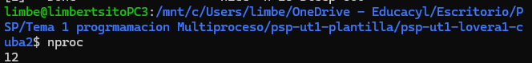 Mi pc tiene 12 Núcleos.
- 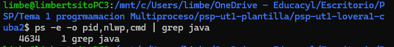 Tiene un hilo porque mi IDE se ejecuta en windows.
### B1.2 · Árbol genealógico
-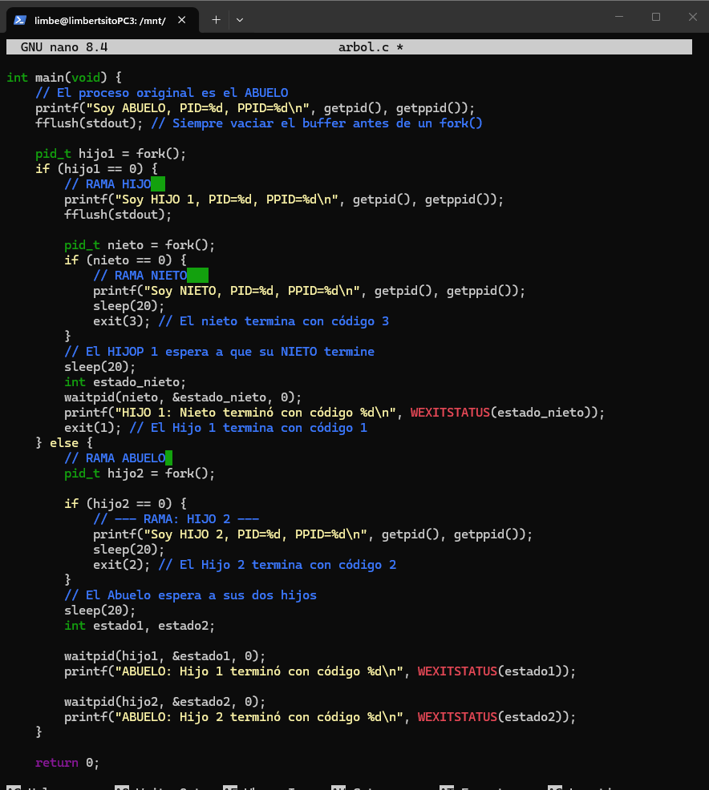
-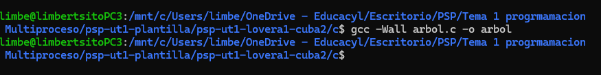
- 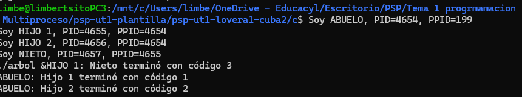
-Salda del programa
Soy ABUELO, PID=4654, PPID=199
Soy HIJO 1, PID=4655, PPID=4654
Soy HIJO 2, PID=4656, PPID=4654
Soy NIETO, PID=4657, PPID=4655
HIJO 1: Nieto terminó con código 3
ABUELO: Hijo 1 terminó con código 1
ABUELO: Hijo 2 terminó con código 2
- 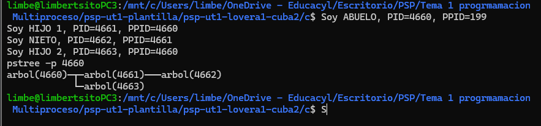
### B1.3 · ¿Cuántos procesos?
| Fragmento | Predicción | Resultado real | Explicación |
|-----------|----------- |----------------|-------------|
| A         | 4          |        4       | Hay una formula que es 2^n procesos, siendo n el numero de llamadas al fork()|
| B         |3           |     4          | Se crean 4 procesos en total el principal y las 3 iteraciones del bucle|

### B1.4 · Lanzador
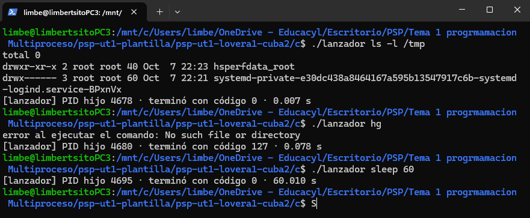
### B1.5 · Zombis y huérfanos
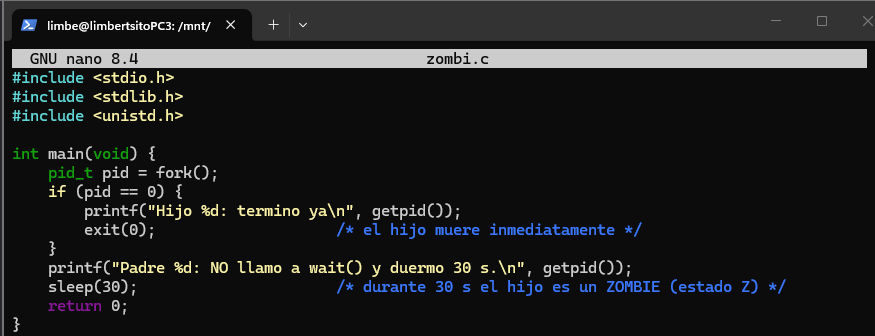
-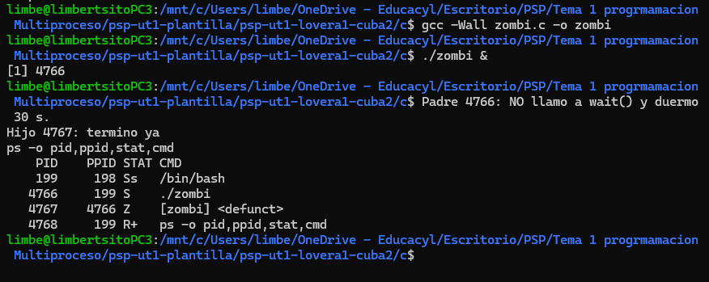
-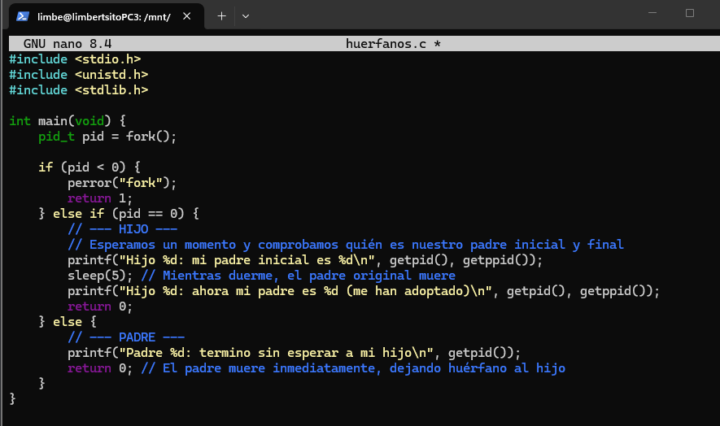
-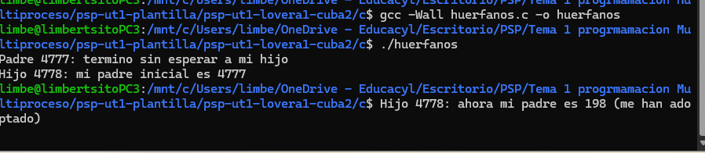
- Un Proceso zombi no consume recursos de la CPU porqeu ya ha finalizado su ejecucion, y el SO ya ha liberado su memoria privada
- Solo sobrevive su BCP , el cual gaurda su codigo de slaida para que lo pueda recoger mediante unallamada a wait())
- Aunque no gaste ciclos de reloj ni memoria activa, ocupa una entrada en la tabla de procesos del sistema operativo. Dado que el número de identificadores de proceso (PIDs) disponibles en el sistema es finito, acumular zombis descontroladamente degrada los recursos del kernel.
### B1.6 · ★ Tubería (opcional)

## B2 · Crear y controlar procesos en Kotlin
### B2.1 · Ejecutor
### B2.2 · Mini-ps
### B2.3 · Vigilante
| Caso | Código de salida | Explicación |
|------|:----------------:|-------------|
| Cierre normal | | |
| `destroy()` | | |
| `destroyForcibly()` | | |D

## B3 · Comunicación entre procesos
### B3.1 · Cifrado César
### B3.2 · Almacén clave-valor
### B3.3 · Tuberías nativas y redirecciones

## B4 · Sincronización y varias tareas en paralelo
### B4.1 · Primos en paralelo
Núcleos del equipo: [ ]

| K (procesos) | Tiempo (s) | Aceleración (T₁ / Tₖ) |
|:------------:|:----------:|:---------------------:|
| 1 | | 1,00 |
| 2 | | |
| 4 | | |
| nº de núcleos | | |
| 2 × nº de núcleos | | |

Análisis:

### B4.2 · Pool de procesos
### B4.3 · Tareas con dependencias

## B5 · Proyecto integrador
| # | Caso | Resultado obtenido | ¿Correcto? |
|:-:|------|--------------------|:----------:|
| 1 | Varios ficheros, uno grande | | |
| 2 | Fichero vacío | | |
| 3 | Fichero sin permiso de lectura | | |
| 4 | Fichero lento (timeout) | | |
| 5 | Directorio inexistente o sin `.txt` | | |
| 6 | Rendimiento: `--secuencial` vs `--max` 1, 2, 4 | | |
| 7 | Nunca más de `--max` trabajadores vivos | | |

Conclusiones de rendimiento:
